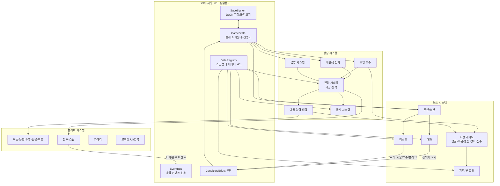
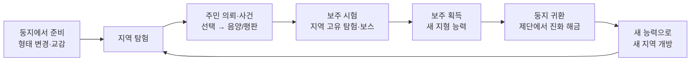

# 용의 전설 - 이무기의 탄생 : 전체 기획 구조

> 문서 버전 0.1 (2026-11-16) · 대상: Godot 4 기반 Android 로컬 싱글플레이
> 이 문서 묶음은 기획서 17장 "첫 번째 작업 요청"의 결과물 10개 항목을 정리한 것이다. 코드는 아직 작성하지 않는다.

## 문서 목록

| 번호 | 파일 | 담당 항목 |
|---|---|---|
| 00 | `00_개요와_시스템구조.md` (이 문서) | ① 전체 게임 시스템 구조도, 핵심 설계 결정, 충돌 점검표 |
| 01 | `01_스토리.md` | ② 메인 스토리, ③ 오행 보주 지역별 스토리 |
| 02 | `02_음양_진화_둥지.md` | ④ 음양 획득 규칙, ⑤ 진화 14종 조건, ⑥ 둥지 성장 |
| 03 | `03_이동_비행_전투.md` | ⑦ 이동, 비행, 전투 시스템 |
| 04 | `04_MVP_범위와_구현순서.md` | ⑧ MVP 개발 범위와 구현 순서 |
| 05 | `05_데이터구조.md` | ⑨ 게임 데이터 구조 |
| 06 | `06_모바일_최적화.md` | ⑩ 모바일 최적화 계획 |

---

## 1. 핵심 설계 결정 (모든 문서가 따르는 규칙)

이 결정들은 시스템끼리 충돌하지 않도록 먼저 고정한 것이다. 이후 문서는 모두 이 규칙을 전제로 한다.

1. **세 가지 성장 축은 서로 독립이다.**
   - **레벨/경험치**: 체력, 공격력 같은 기본 수치. 진화와 무관하게 계속 오른다.
   - **오행 보주(5종)**: 어떤 *속성*의 용이 될 수 있는지 결정. 획득 후 영구 보유, 절대 소모되지 않는다.
   - **음양 기운(양, 음 두 개의 누적값)**: 같은 속성 안에서 *양/음 방향*을 결정. 계속 변한다.
2. **해금과 장착은 분리한다.** 진화 형태는 "조건 충족 → 해금(영구)" 과 "제단에서 장착(언제든 변경)" 두 단계다. 음양 수치가 나중에 바뀌어도 이미 해금한 형태는 사라지지 않는다.
3. **평판(주민 관계)은 음양과 별개 수치다.** 음의 행동이 곧 "주민에게 미움받음"이 아니다. 예를 들어 탐욕스러운 지주의 재물을 빼앗으면 음이 오르지만 소작농들의 신뢰는 오른다. 이로써 "음 플레이 = 마을 진행 불가" 같은 막힘을 막는다.
4. **메인 스토리와 보주 퀘스트는 양 루트와 음 루트 모두로 완료할 수 있다.** 선택은 결과(대사, 보상 기운, 주민 반응, 후일담)를 바꾸지만 진행을 막지 않는다.
5. **월드는 하나의 거대한 오픈월드가 아니라 "지역 씬" 단위다.** 지역끼리는 경계 이동 또는 둥지/하늘길 이동으로 연결한다. 비행도 지역 안에서 이뤄진다. 모바일 성능과 개발 규모를 동시에 잡기 위한 결정이다.
6. **용 모델은 하나의 공통 골격(리그)을 공유하고 부위(뿔, 갈기, 꼬리, 비늘 텍스처, 이펙트)를 교체해 만든다.** 색만 바꾸는 방식은 피하되, 14종을 각각 처음부터 모델링·리깅하지 않는다.
7. **모든 콘텐츠는 문자열 ID 기반 데이터(리소스 파일)로 정의한다.** 오행, 진화, 지역, 퀘스트, NPC, 대사를 코드 수정 없이 추가할 수 있게 한다. 해금 조건과 보상은 공통 "조건(Condition)"/"효과(Effect)" 형식 하나로 표현한다.
8. **반복 행동으로 얻는 음양 기운에는 상한이 있다.** 플레이 시간을 반복 퀘스트로 늘리지 않는다는 원칙을 수치로 보장한다.

---

## 2. 전체 게임 시스템 구조도

### 2.1 계층 구조

### 2.2 데이터 흐름 한 줄 요약

> **행동**(대화 선택·퀘스트·전투) → **효과**(양/음 +, 보주 획득, 평판 변화, 플래그) → **GameState** 갱신 → **조건** 재평가 → 진화 해금 / 지역 개방 / 퀘스트 개방 / 주민 반응 변화 / 둥지 단계 상승

모든 시스템은 서로 직접 호출하지 않고 GameState와 EventBus를 통해 연결한다. 그래서 새 시스템(예: 업적)을 붙일 때 기존 코드를 고칠 필요가 없다.

### 2.3 플레이 루프

### 2.4 성장 단계 (이무기 → 용 → 각성 → 신격)

| 단계 | 진입 조건 | 이동 능력 | 둥지 단계 |
|---|---|---|---|
| 1. 새끼 이무기 | 시작 | 지상 이동, 얕은 물 | 1. 작은 동굴 |
| 2. 성체 이무기 | 레벨 5 + 프롤로그 완료 | + 수영/잠수(얕은), 등반 | 1. 작은 동굴 |
| 3. 활강 이무기 | 레벨 8 + 목 보주 시험 중반 | + 짧은 활공 | 1. 작은 동굴 |
| 4. 용 (첫 진화) | 첫 보주 획득 + 레벨 10 | + 자유 비행 | 2. 오행의 둥지 |
| 5. 각성룡 | 보주 3개 + 각성 퀘스트 | + 고속 비행, 급강하 | 3. 신령의 안식처 |
| 6. 신격 (엔드게임) | 보주 5개 + 최종장 클리어 | + 특수 이동(순간 승천 등) | 4. 오행의 성역 |

---

## 3. 시스템 충돌 점검표

설계하면서 발견한 충돌 가능성과 해결 방법이다. 이후 기획 변경 시에도 이 표로 점검한다.

| # | 충돌 가능성 | 해결 |
|---|---|---|
| 1 | 음으로 플레이하면 주민이 적대해서 메인 퀘스트를 못 받는다 | 평판과 음양 분리(결정 3). 메인/보주 퀘스트는 평판 조건을 걸지 않는다. 평판은 부가 사건과 대사에만 영향. |
| 2 | 청룡을 해금한 뒤 독목룡을 얻으려면 음을 다시 쌓아야 하는데, 양 수치가 높아 뒤집기 힘들다 | 진화 방향은 누적 총량이 아니라 **성향 게이지**(획득량의 절반만큼 움직이는 -100~+100 값)로 판정한다(02 문서 1.1, 2.3). 반대 방향으로 몇 개 사건만 진행하면 뒤집을 수 있다. |
| 3 | 수(水) 보주는 용궁에서 얻는데 용궁은 수의 힘(심수 잠수)이 있어야 들어간다 (순환 의존) | 수 보주는 호수 상층 "경호"에서 얻고, 용궁 심층은 보주 획득 *후* 열리는 부가 지역으로 둔다. 전체 게이트 순서는 01 문서 3.0에서 순환 없이 검증. |
| 4 | 진화 형태 변경 시 스킬/장비가 꼬인다 | 스킬은 형태에 종속(장착 시 자동 교체), 레벨·아이템·장신구는 형태와 무관하게 유지. 형태별 개별 성장치는 두지 않는다. |
| 5 | 비행이 생기면 지상 게이트(덩굴·바위)를 무시하고 날아서 넘어간다 | 게이트는 "동굴 내부", "지하", "수중", "봉인된 실내" 처럼 하늘에서 접근 불가한 곳에 둔다. 야외 높은 곳은 원래 비행 보상 지역으로 설계. |
| 6 | 히든 진화 "혼돈룡(균형)"과 "천룡/마룡(극대화)" 조건이 동시에 성립할 수 없어 한 회차에 모두 얻을 수 없다 | 판정 시점의 성향 게이지 기준이라, 게이지를 이동시키면 같은 세이브에서 모두 해금 가능. 각 히든은 해금 퀘스트를 1회만 깨면 영구 보유. |
| 7 | 반복 사냥/반복 의뢰로 음양을 무한히 쌓는다 | 반복 가능 행동은 지역별·일(게임 내 하루)별 상한. 큰 기운은 일회성 사건에서만. |
| 8 | 둥지 테마 5종 × 단계 4종 = 20벌 에셋 필요 | 단계는 공통 지형(메시), 테마는 소품 세트 + 머티리얼/조명 교체로 구현. 실제 제작물은 지형 4 + 소품 세트 5. |
| 9 | 용 14종 × 고유 모델 제작 부담 | 공통 리그 + 부위 교체(결정 6). 히든 4종만 고유 실루엣 부위를 추가 제작. |
| 10 | 모바일 조작이 스킬 증가로 복잡해진다 | 버튼 고정 6개(공격, 회피, 오행기, 음양기, 궁극기, 상황형 상호작용). 형태가 바뀌어도 버튼 수는 같고 내용만 교체. |

---

## 4. 초기 버전 범위에서 제외하는 것

규모를 키우는 기능은 아래처럼 정리한다. "제외"는 영원히 빼는 것이 아니라, 데이터 구조상 나중에 붙일 자리는 남겨둔다는 뜻이다.

- 서버, 로그인, 랭킹, 거래, 멀티플레이, 클라우드 저장 (기획서 14장대로 제외)
- 심리스 오픈월드 (지역 씬 방식으로 대체)
- 자유 배치형 둥지 꾸미기 (MVP 이후에도 "슬롯형 배치"로 시작)
- 형태별 개별 레벨/스킬트리 (단일 레벨 + 형태별 고정 스킬)
- 낮밤/날씨 실시간 시뮬레이션 (지역별 고정 시간대, 이후 단순 2단계 낮/밤만 고려)
- 음성 더빙, 풀 컷신 (MVP는 대사창 + 카메라 연출, 진화 연출만 전용 시퀀스)
- 장비 파밍/강화 시스템 (장신구 몇 종 수준만)
- 유료 결제 (출시 전 별도 기획. 구조상 꾸미기 아이템 정도만 고려)
