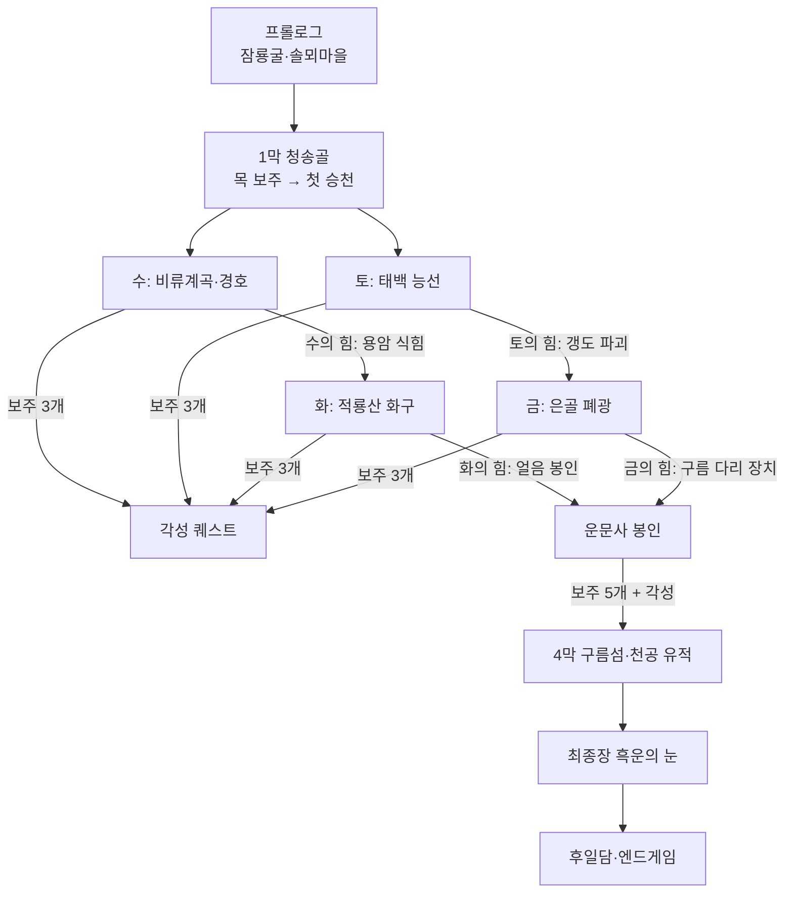
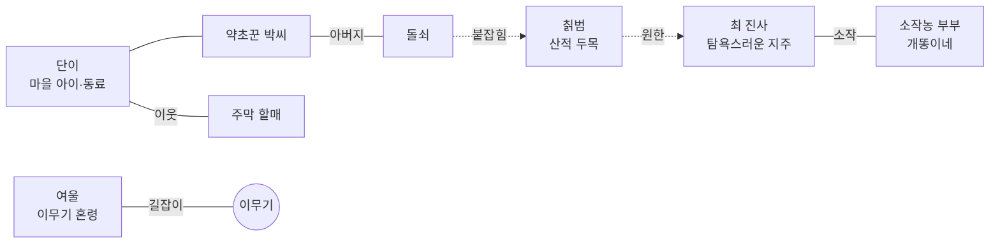

# 01. 스토리 : 메인 스토리와 오행 지역별 스토리

## 1. 세계관 요약

- **무대**: 조선 중기를 닮은 가상의 나라 "청구(靑丘)". 실제 역사 사건과 인물은 쓰지 않고, 조선의 생활상(마을, 장터, 관아, 사찰, 서원)과 한국 설화(이무기, 용, 산신, 도깨비, 구미호, 용왕, 장승)를 결합한다.
- **핵심 갈등**: 백 년 전 "하늘문(天門)"이 닫혀 이무기들이 더 이상 승천하지 못하게 되었다. 하늘문을 닫은 것은 오행의 균형을 깨뜨린 "흑운(黑雲)" 사건이며, 그 여파로 각 지역의 수호신령이 힘을 잃고 오행 보주가 흩어졌다.
- **주인공**: 작은 동굴 "잠룡굴"에서 깨어난 새끼 이무기. 이름은 플레이어가 짓는다(기본값: "미르"). 말은 하지 못하지만 몸짓과 선택지로 의사를 표현하고, 마을 아이 "단이"를 통해 주민과 소통하게 된다.
- **여의주 설정**: 용이 되려면 여의주가 필요하다. 이 세계의 여의주는 다섯 오행 보주의 힘이 모여야 완성되며, 보주 하나만으로도 "불완전한 여의주"가 되어 첫 승천(용 진화)은 가능하다. 보주가 늘어날수록 여의주가 완성에 가까워진다.

## 2. 메인 스토리 (프롤로그 ~ 최종 진화)

전체를 프롤로그 + 5막 + 최종장 + 후일담으로 구성한다. 막은 진행 순서이며, 2막과 3막 일부는 플레이어가 순서를 고를 수 있다.

### 프롤로그 : 잠룡굴의 깨어남 (튜토리얼, MVP 포함)
1. 잠룡굴에서 알을 깨고 나온다. 지상 이동, 카메라, 얕은 물 이동을 배운다.
2. 동굴 깊은 곳의 낡은 제단(훗날 "오행 제단")에서 희미한 목소리 "늙은 이무기 혼령 '여울'"이 말을 건다. 여울은 백 년 전 승천에 실패한 이무기의 혼령이며 길잡이 역할을 한다.
3. 동굴 밖으로 나가 마을 "솔뫼마을"을 발견한다. 마을 사람들은 처음에 이무기를 두려워한다(초기 평판: 경계).
4. 마을 아이 **단이**가 들개에게 쫓기는 장면에서 첫 선택을 한다.
   - 들개를 쫓아내고 단이를 구한다 → 양 +
   - 들개 무리의 우두머리를 위협해 복종시킨다(단이도 구해짐) → 음 +
   - 어느 쪽이든 단이는 이무기를 친구로 여기게 되고, 이후 통역자이자 동료 NPC가 된다.

### 1막 : 솔뫼마을과 청송골 (목 보주, MVP 포함)
- 마을의 사건(의뢰 3~4개)을 해결하며 성체 이무기로 성장한다. 수영·등반을 배운다.
- 마을 뒷산 숲 "청송골"이 시들어 가고, 산삼밭과 우물이 말라 간다는 사실을 알게 된다.
- 원인은 목의 수호신령 **"노송령(老松靈)"** 이 흑운의 기운에 잠식되어 숲을 스스로 갉아먹고 있기 때문이다.
- 목 보주 시험(아래 3.1)을 통과하면 첫 보주를 얻고, 잠룡굴 제단에서 **첫 승천** 이벤트가 일어난다. 당시 성향에 따라 **청룡** 또는 **독목룡**으로 진화한다.
- 승천 연출: 동굴 천장을 뚫고 솟구쳐 마을 위를 한 바퀴 비행한다. 주민들의 반응 연출은 평판에 따라 달라진다(환호, 경외, 두려움).
- 1막 종료 시 둥지가 "오행의 둥지"(2단계)로 성장하고 자유 비행이 해금된다. 하늘에서 보니 북쪽 하늘에 검은 구름 소용돌이(흑운)가 보인다. **MVP는 여기서 끝난다.**

### 2막 : 물과 산 (수·토 보주, 순서 자유)
- 하늘을 날 수 있게 되자 두 지역이 동시에 열린다: 동쪽의 **비류계곡과 경호(수)**, 서쪽의 **태백 능선(토)**.
- 두 지역 모두에서 "흑운을 퍼뜨리는 무리" **흑운회(黑雲會)** 의 흔적을 발견한다. 흑운회는 수호신령의 힘을 훔쳐 스스로 신선이 되려는 도사 집단이다.
- 흑운회는 단순 악당이 아니다. 몇몇은 가뭄과 흉년으로 가족을 잃은 사람들이며, 플레이어는 그들과 협력(음)하거나 저지(양)할 수 있다. 협력해도 보주 시험은 진행된다(흑운회의 정보를 얻는 대신 신령에게 의심받는 식으로 대사·과정이 달라짐).

### 3막 : 불과 쇠 (화·금 보주)
- **화**: 수 보주의 힘(물길로 용암을 식힘)으로 화산 지대 **"적룡산 화구"** 진입.
- **금**: 토 보주의 힘(무너진 갱도 파괴)으로 **"은골 폐광과 고대 금속 유적"** 진입.
- 보주 3개를 모으면 여울이 **각성 퀘스트**를 연다. 잠룡굴 깊은 곳 "여울의 무덤"에서 여울이 실패했던 승천의 기억을 체험한다. 완료하면 **각성룡**(고속 비행, 급강하)이 되고 둥지가 "신령의 안식처"(3단계)가 된다.
- 3막 후반에 흑운회의 수장 **"현무진인(玄霧眞人)"** 이 사실 백 년 전 여울과 함께 승천하려던 인간 수행자였음이 드러난다. 여울이 승천에 실패한 것은 그를 구하려다 하늘문 시험을 포기했기 때문이다.

### 4막 : 하늘문으로 가는 길
- 다섯 번째 보주까지 모으면 여의주가 완성 단계에 이르고, 오래된 사찰 **"운문사"** 의 얼어붙은 봉인(화 보주로 녹임) 안쪽에서 천공 유적으로 가는 **구름 다리 장치**(금 보주로 작동)를 찾는다.
- **구름섬과 천공 유적** 탐험. 고속 비행이 필수인 비행 도전 구간과 공중 전투가 중심이다.

### 최종장 : 흑운의 눈
- 하늘문 앞에서 현무진인과 대면한다. 그는 보주를 모두 흡수해 하늘문을 강제로 열려 한다.
- 최종 전투는 현무진인이 흑운을 두른 거대한 "흑룡의 형상"으로 변하는 공중전이다.
- **결말 선택(영향만 다르고 엔딩 크레딧은 공통)**:
  - 정화(양): 현무진인의 흑운을 정화해 인간으로 되돌린다. 여울의 혼령이 함께 승천한다.
  - 흡수(음): 현무진인의 힘을 흡수해 흑운을 통제한다. 여울은 플레이어 안에 깃든다.
  - 공존(균형, 조건부): 양 누적과 음 누적이 각각 800 이상이면 나타나는 선택지. 흑운을 하늘문의 문지기로 남긴다. 혼돈룡 해금 조건 중 하나.
- 결말 후 하늘문이 열리고 플레이어는 **신격** 단계에 오른다. 둥지가 "오행의 성역"(4단계)이 된다.

### 후일담 (엔드게임)
- 엔딩 후에도 세계는 계속된다. 결말 선택에 따라 주민 대사와 일부 지역 분위기가 바뀐다.
- 용궁 심층, 숨겨진 유적, 지역별 상위 보스, 비행 도전, 히든 진화 퀘스트, 도감 수집이 남는다.
- 향후 업데이트용 고리: 하늘문 너머 "천계" 지역, 새 오행 변형(예: 뇌(雷), 빙(氷)) 등.

### 메인 스토리 흐름도

---

## 3. 오행 보주 획득 지역별 스토리

### 3.0 지역 게이트 순서 검증 (순환 의존 없음)

| 지역 | 진입 조건 | 획득 보주 | 보주가 여는 곳 |
|---|---|---|---|
| 청송골 (목) | 시작 지역 | 목 | 덩굴 다리 → 비류계곡 지상 루트, 각 지역 덩굴 벽 |
| 비류계곡·경호 (수) | 비행 또는 덩굴 다리 | 수 | 심수 잠수 → 용궁 심층(부가), 용암 냉각 → 화산 |
| 태백 능선 (토) | 비행 | 토 | 바위 파괴 → 은골 폐광 |
| 적룡산 화구 (화) | 수 보주 | 화 | 얼음 봉인 해제 → 운문사 내부 |
| 은골 폐광 (금) | 토 보주 | 금 | 고대 장치 → 구름 다리 |
| 운문사 → 천공 유적 | 화 + 금 보주 + 각성 | (최종장) | 하늘문 |

모든 진입 조건이 앞선 단계 결과만 참조하므로 순환이 없다. 수와 토는 순서를 고를 수 있어서 플레이어 동선이 한 줄로만 고정되지 않는다.

각 지역은 같은 틀로 설계한다: **(1) 지역 사건 도입 → (2) 주민 의뢰 2~3개(음양 선택 포함) → (3) 속성 고유 탐험 기믹 → (4) 수호신령의 시험(보스 또는 퍼즐) → (5) 양/음 해결 방식 선택 → (6) 보주 획득과 지역 변화.**

### 3.1 목(木) : 청송골의 시든 노송 (MVP)

- **분위기**: 소나무와 대나무 숲, 산삼밭, 서낭당, 장승. 초록이 누렇게 시들어 가는 중.
- **주요 인물**
  - **약초꾼 박씨**: 숲이 시들어 생계를 잃음. 숲 깊은 곳으로 간 아들 **돌쇠**를 찾아 달라고 한다.
  - **산적 두목 "칡범"**: 숲 입구에 진을 치고 약초를 독점하는 도적. 실은 마을 지주 **최 진사**에게 땅을 빼앗긴 화전민 출신.
  - **최 진사**: 탐욕스러운 지주. 숲의 산삼을 몰래 캐어 팔고 있다.
  - **노송령**: 목의 수호신령. 흑운에 잠식된 거대한 소나무 정령.
- **진행**
  1. 돌쇠 찾기(조사·탐험): 발자국과 부러진 가지를 따라 숲을 수색. 돌쇠는 칡범 무리에게 붙잡혀 있다.
  2. 칡범과의 대면(선택):
     - 양: 칡범과 결투해 이기고 돌쇠를 풀어주게 한다. 칡범 무리를 설득해 숲 복원을 돕게 한다.
     - 음: 칡범과 손잡고 최 진사의 산삼 창고를 털어 준다(잠입). 대가로 돌쇠를 돌려받는다.
     - 어느 쪽이든 "숲 깊은 곳 노송 아래에 검은 안개가 있다"는 정보를 얻는다.
  3. **목 고유 기믹 - "생장의 길"**: 시든 덩굴에 이무기의 기운을 불어넣어 잠깐 살려 발판을 만든다(타이밍 퍼즐). 이 단계에서 **짧은 활공**을 배운다(절벽에서 절벽으로).
  4. **수호신령의 시험**: 노송령 보스전. 뿌리 공격을 피하며 몸통의 검은 옹이 3곳을 공격.
  5. 마무리 선택:
     - 양: 노송령의 흑운을 정화한다 → 숲이 즉시 푸르러지고, 노송령이 보주를 내어준다.
     - 음: 노송령에 깃든 흑운을 흡수한다 → 숲은 천천히 회복되며, 이무기의 비늘에 독목의 기운이 스민다.
- **결과 및 지역 변화**: 목 보주 획득. 청송골이 푸르게 변하고(지역 상태 플래그), 박씨 가족 관계 변화, 칡범 무리는 양 루트면 숲지기, 음 루트면 마을 밖 협력자가 된다.
- **해금 능력**: "생장" - 지정된 덩굴 지점에서 덩굴 다리/덩굴 벽을 만든다.

### 3.2 수(水) : 비류계곡과 경호의 마른 용소

- **분위기**: 폭포와 계곡, 물레방아, 나루터, 넓은 호수 "경호"와 섬 위의 정자.
- **사건**: 가뭄으로 계곡 물이 줄고, 호수 한가운데 용소(龍沼)가 말라간다. 기우제를 지내려는 마을 사람들과, 물길을 막아 호수 물을 독점하려는 흑운회 도사가 갈등한다.
- **주요 인물**: 나루터 뱃사공 **할멈 "물새댁"**, 기우제를 준비하는 무당 **"연화"**, 흑운회 도사 **"청묵"**(가뭄에 딸을 잃음), 수의 수호신령 **"경호 용녀"**.
- **진행**
  1. 계곡 상류의 막힌 물길 조사(조사·탐험), 수중 동굴 탐험(수영).
  2. 청묵과의 대면: 양 - 물길 둑을 무너뜨리고 청묵을 설득 / 음 - 청묵과 거래해 둑의 물을 원하는 마을로만 흘려보냄(선택한 마을 평판 상승, 다른 마을 하락).
  3. **수 고유 기믹 - "물길 잇기"**: 수문과 물레방아를 조작해 물을 흘려보내 경로를 만드는 퍼즐. 물이 차오른 구간을 헤엄쳐 진행.
  4. 수호신령의 시험: 경호 용녀의 "거울 호수" 시험. 수면 위·아래 두 세계를 오가며 진짜 용녀를 찾는 퍼즐형 보스.
  5. 마무리 선택: 양 - 기우제를 도와 비를 내림 / 음 - 용소의 물기운을 흡수하고 비는 필요한 만큼만 내림.
- **해금 능력**: "심수" - 깊은 물 잠수(용궁 심층 진입), "냉각" - 지정 지점의 용암 흐름을 식혀 길을 만든다.

### 3.3 토(土) : 태백 능선의 울부짖는 산

- **분위기**: 높은 암벽과 산맥, 산신각, 약초 동굴, 낙석.
- **사건**: 산이 밤마다 울며 산사태가 잦다. 산신 **"태백 산군(호랑이 형상)"** 이 흑운에 잠식되어 산을 흔들고 있다.
- **주요 인물**: 산 속 화전민 마을 촌장 **"억쇠 영감"**, 금광을 노리는 관아 군관 **"윤 군관"**, 산신의 심부름꾼 까치 **"깍깍이"**.
- **진행**
  1. 산사태에 갇힌 화전민 구조(구조·탐험, 비행 활용).
  2. 윤 군관과의 대면: 양 - 화전민 편에서 군관의 무리한 채굴을 막음 / 음 - 군관에게 겁을 주어 금광 지분을 빼앗고 채굴을 대신 통제.
  3. **토 고유 기믹 - "지맥 읽기"**: 바위 지대에서 진동 소리를 따라 지맥 노드를 찾아 순서대로 누르는 탐색 퍼즐. 진행 중 낙석 회피 구간.
  4. 수호신령의 시험: 태백 산군 보스전. 산군이 일으키는 지형 변화(솟아오르는 암석 기둥)를 이용해 공격 지점에 접근.
  5. 마무리 선택: 양 - 산군을 진정시킴 / 음 - 산군을 굴복시켜 산을 다스림.
- **해금 능력**: "분쇄" - 금 간 바위와 무너진 갱도 파괴.

### 3.4 화(火) : 적룡산 화구의 꺼지지 않는 불

- **분위기**: 화산 지대, 용암 강, 붉은 수정, 대장간 마을.
- **사건**: 화산 아래 대장간 마을 **"불매골"** 의 대장장이들이 흑운회를 위해 강제로 무기를 만들고 있다. 화산의 불은 꺼지지 않고 점점 거세진다.
- **주요 인물**: 대장장이 장인 **"쇠돌 아범"**, 그의 딸이자 견습 대장장이 **"불이"**, 흑운회 간부 **"적연"**, 화의 수호신령 **"주작 화령"**.
- **진행**
  1. 수 보주의 냉각으로 용암 길을 식혀 진입.
  2. 대장간 잠입(잠입): 양 - 갇힌 대장장이 구출 / 음 - 흑운회의 무기를 빼돌려 내 것으로(전투 보조 아이템).
  3. **화 고유 기믹 - "불씨 옮기기"**: 꺼진 화로들에 불을 옮겨 붙여 거대한 풀무 장치를 작동시키는 시간 제한 퍼즐. 열기 구역에서는 체력이 서서히 줄어드는 환경 위험.
  4. 수호신령의 시험: 주작 화령의 공중전(첫 본격 공중 보스).
  5. 마무리 선택: 양 - 화령을 정화하고 불을 다스림 / 음 - 화령의 화기를 흡수.
- **해금 능력**: "용화" - 얼음 봉인과 얼어붙은 장치 해제.

### 3.5 금(金) : 은골 폐광의 잠든 기계

- **분위기**: 버려진 은광, 광차 레일, 고대 금속 유적(삼국 이전 고대 문명의 청동/은 장치).
- **사건**: 폐광 깊은 곳에서 고대 청동 장치가 깨어나 광부들을 공격한다. 흑운회가 이 장치를 무기로 쓰려 한다.
- **주요 인물**: 폐광에 숨어 사는 늙은 광부 **"은복 노인"**, 고대 장치를 연구하는 실학자 선비 **"정 선비"**, 금의 수호신령 **"백호 금령"**(유적의 수호 기계와 융합한 신령).
- **진행**
  1. 토 보주의 분쇄로 무너진 갱도를 뚫고 진입.
  2. 광차 추격 구간(탐험·액션), 은복 노인 구조.
  3. 정 선비와의 선택: 양 - 장치를 봉인해 아무도 못 쓰게 함 / 음 - 장치의 제어권을 차지해 내 편으로(이후 부가 콘텐츠에서 소환 장치로 활용).
  4. **금 고유 기믹 - "공명"**: 금속 장치에 일정한 주파수로 울림을 보내 톱니와 문을 맞추는 리듬/패턴 퍼즐.
  5. 수호신령의 시험: 백호 금령 보스전. 장갑을 벗겨내는 단계형 전투.
- **해금 능력**: "공명" - 고대 금속 장치 작동(구름 다리, 비밀 문).

---

## 4. 주요 NPC 관계도 (1막 기준, MVP 데이터의 기준 예시)

MVP 마을 NPC는 단이, 박씨, 돌쇠, 칡범, 최 진사, 주막 할매, 개똥이네(소작농) 7명 수준으로 제한한다.
