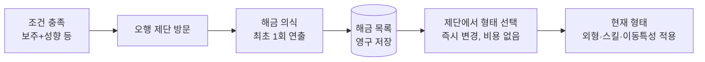

# 02. 음양 · 진화 · 둥지

## 1. 음양 시스템 : 구체적인 획득 규칙

### 1.1 수치 구성

음양은 세 개의 값으로 관리한다. 하나의 값으로 관리하면 "양을 쌓으면 음이 깎이는" 구조가 되어 혼돈룡(균형) 조건과 "누적 성장" 개념이 충돌하기 때문이다.

| 값 | 범위 | 의미 | 변화 |
|---|---|---|---|
| **양 누적 (yang_total)** | 0 ~ 무한 | 지금까지 쌓은 양의 총량. 절대 줄지 않는다. | 양 행동 시 증가 |
| **음 누적 (yin_total)** | 0 ~ 무한 | 지금까지 쌓은 음의 총량. 절대 줄지 않는다. | 음 행동 시 증가 |
| **성향 (tendency)** | -100 ~ +100 | 현재 기울기. +는 양, -는 음. | 양 행동 시 +, 음 행동 시 - (획득량 ÷ 2, 범위 고정) |

- **누적값**은 히든 진화와 장기 성장(성향 특성 등급) 조건에 쓴다. 플레이한 만큼 쌓이는 "경력"이다.
- **성향**은 진화 방향, 주민 첫인상 대사, 성향 특성에 쓴다. 계속 움직이므로 플레이어가 원하는 쪽으로 언제든 다시 기울일 수 있다.
- UI 표시: 둥지와 메뉴에서 태극 문양 게이지 하나로 성향을 보여주고, 그 옆에 양/음 누적값을 작게 표시한다. 필드에서는 기운을 얻을 때만 문양이 잠깐 떠오른다.

### 1.2 획득량 등급

| 등급 | 양/음 획득량 | 성향 이동 | 출처 | 반복 여부 |
|---|---|---|---|---|
| 미세 | 2 | ±1 | 전투 마무리 선택(흡수/놓아주기), 동물 보호/사냥 | 반복 가능(상한 적용) |
| 소 | 10 | ±5 | 주민 소의뢰, 소규모 사건 선택 | 의뢰당 1회 |
| 중 | 30 | ±15 | 지역 사건의 주요 선택, 도적/흑운회 관련 분기 | 1회 |
| 대 | 60 | ±30 | 보주 시험 마무리 선택, 막 단위 스토리 선택 | 1회 |
| 특대 | 100 | ±50 | 최종장 결말 선택, 히든 사건 | 1회 |

### 1.3 행동별 규칙

**양(陽) : 보호 · 회복 · 신뢰 · 생명력**

| 행동 | 등급 | 판정 방식 |
|---|---|---|
| 주민의 부탁 해결 (양 방식) | 소 | 퀘스트 완료 효과 |
| 위험에 처한 주민 구출 | 소~중 | 구조 이벤트 완료 효과 |
| 야생 동물 보호 (덫 풀기, 다친 동물 치료) | 미세 | 상호작용 오브젝트 |
| 마을을 위협하는 몬스터 퇴치 | 미세(일반)/소(지역 위협 보스) | 처치 시 해당 몬스터가 "위협" 태그일 때만 |
| 쓰러뜨린 적을 놓아주기 / 정화 | 미세 | 전투 마무리 선택 |
| 타인을 위한 희생 (보상 포기, 대신 피해 감수) | 중 | 대화 선택지 |
| 보주 시험에서 수호신령 정화 | 대 | 스토리 분기 |

**음(陰) : 공격 · 흡수 · 지배 · 은신 · 기습**

| 행동 | 등급 | 판정 방식 |
|---|---|---|
| 도적·흑운회와 협력 | 중 | 스토리 분기 |
| 적을 기습 (발각되지 않은 상태에서 첫 공격) | 미세 | 전투 이벤트 |
| 위협으로 굴복시키기 (싸우지 않고 물러나게 함) | 소 | 대화 선택지 / 위협 스킬 |
| 탐욕스러운 인물에게서 재물 탈취 | 소~중 | 잠입 퀘스트 완료 효과 |
| 쓰러뜨린 적의 힘을 흡수 | 미세 | 전투 마무리 선택 |
| 자신의 이익을 위한 선택 (보상을 더 받거나 독차지) | 소~중 | 대화 선택지 |
| 보주 시험에서 수호신령의 힘 흡수 | 대 | 스토리 분기 |

**어느 쪽도 아닌 행동**: 일반 몬스터 처치(위협 태그 없음), 채집, 탐험, 퍼즐 해결은 경험치만 준다. 그래서 음양은 오직 "선택"과 "방식"에서만 생긴다.

### 1.4 반복 상한 (반복 플레이 방지)

- "미세" 등급 행동은 **지역별·성향별로 상한**이 있다. 지역의 스토리 단계(도입 → 사건 해결 → 보주 획득)마다 양 30, 음 30까지만 오른다. 지역 하나에서 반복 행동으로 얻을 수 있는 최대치는 각 90이다.
- 상한에 도달하면 해당 행동 시 문양이 회색으로 뜨며 "이 땅의 기운은 이미 충분히 응답했다" 같은 짧은 문구를 띄운다(조용한 안내, 팝업 아님).
- "소" 이상은 모두 일회성이므로 상한이 필요 없다.

### 1.5 전체 획득량 설계 (밸런스 기준)

본편(최종장까지) 기준 양 루트 위주로 진행한 플레이어가 얻는 대략적 양:

| 출처 | 대략 개수 | 합계 |
|---|---|---|
| 보주 시험 마무리(대) | 5 | 300 |
| 지역 주요 선택(중) | 지역당 2~3, 총 13 | 390 |
| 의뢰·사건(소) | 총 35 | 350 |
| 반복 행동(미세, 상한) | 지역 6곳 × 최대 90 | 최대 540 |
| 최종장(특대) | 1 | 100 |
| **합계** | | **약 1,100 ~ 1,680** |

따라서 히든 진화 기준을 "한쪽으로 거의 몰아서 플레이하면 본편 후반에 도달" 하는 수준으로 잡는다(아래 3장).

### 1.6 성향 특성 (양과 음 모두 매력적이게)

성향 게이지 위치에 따라 패시브 특성이 붙는다. 진화 형태와 별개로 적용되므로, 어떤 형태든 지금 성향의 맛을 느낄 수 있다.

| 성향 구간 | 이름 | 효과 |
|---|---|---|
| +60 ~ +100 | 양 · 수호 | 회복량 +20%, 피격 시 일정 확률 보호막, 주민 선물/할인, 신령 축복 사건 등장 |
| +20 ~ +59 | 양 · 온기 | 회복량 +10%, 주민 첫인상 호의 |
| -19 ~ +19 | 태극 · 균형 | 양음 스킬 게이지 충전 +15%, 균형 전용 대사·사건(혼돈 계열 복선) |
| -20 ~ -59 | 음 · 그늘 | 치명타 +10%, 적 감지 범위 -15% |
| -60 ~ -100 | 음 · 지배 | 흡수 회복 +20%, 기습 피해 2배, 도적 암시장과 흑운회 정보상 이용 가능 |

양 쪽은 "선물, 할인, 축복 사건", 음 쪽은 "암시장, 정보상, 은신 루트"처럼 **각자에게만 열리는 콘텐츠**를 둬서, 한쪽을 골랐다고 손해 보는 느낌이 없게 한다.

### 1.7 음양과 평판의 관계

- 평판(주민 개인 관계 -100~+100, 마을 분위기)은 **각 행동마다 별도로 지정**한다. 음양 획득과 평판 변화는 독립된 효과다.
- 예: 최 진사의 창고 털기 → 음 +10, 최 진사 관계 -40, 소작농 개똥이네 관계 +20.
- 예: 칡범과 결투 → 양 +30, 칡범 관계 -10(패배의 앙금) 후 설득 성공 시 +30.
- 마을 분위기(평판 평균)는 3단계: **경계**(시작) → **익숙함** → **신뢰** / 또는 **두려움**. 두려움 상태에서도 메인 퀘스트 NPC는 대화가 가능하며, 대사와 부가 사건만 달라진다.

---

## 2. 진화 시스템 개요

### 2.1 해금과 장착의 분리

- **해금 판정 시점**: 플레이어가 오행 제단(둥지)에 갈 때 모든 진화 조건을 재평가한다. 조건을 만족한 형태가 있으면 "해금 의식"을 진행한다. 필드에서 조건을 만족하면 "둥지의 제단이 공명한다" 알림만 띄운다.
- **해금 후**: 음양이 바뀌어도, 무엇이 바뀌어도 해금은 영구적이다.
- **형태 변경**: 제단에서 해금한 형태 중 하나를 고르면 즉시 바뀐다. 비용과 대기 시간은 없다. 변경 연출은 짧게(2~3초, 스킵 가능).
- **변경해도 유지되는 것**: 레벨, 경험치, 스토리 진행도, 보주, 해금 목록, 탐험 기록, 도감, 아이템, 평판, 음양 값. 형태에 따라 바뀌는 것은 외형, 스킬 4종, 이동 특성, 형태별 기본 능력치 보정(±15% 이내)뿐이다.
- **지형 능력은 형태가 아니라 보주에 붙는다.** 청룡이든 백금룡이든 목 보주가 있으면 덩굴 생장을 쓸 수 있다. 그래야 형태를 바꿀 때마다 길이 막히는 문제가 없다. 단, 해당 속성 형태일 때 그 지형 능력이 강화된다(범위 증가 등).

### 2.2 첫 승천 (이무기 → 용)

- 조건: 레벨 10 이상, 보주 1개 이상(본편에서는 목), 해당 지역 보주 시험 완료.
- 첫 승천만은 제단에서가 아니라 보주 획득 직후 잠룡굴 제단으로 이어지는 **스토리 연출**로 진행한다.
- 성향에 따른 결정:
  - 성향 +20 이상 → 양 형태 해금 및 장착
  - 성향 -20 이하 → 음 형태 해금 및 장착
  - -19 ~ +19 (균형) → **플레이어가 둘 중 하나를 고른다**. "결정할 수 없어서 막히는" 경우를 없앤다.

### 2.3 같은 속성의 반대 형태 얻기

- 이미 한 형태를 가진 속성에서 반대 형태를 원하면, 성향을 반대쪽 ±20 너머로 옮긴 뒤 제단에 가면 해금된다.
- 성향 이동량이 획득량의 절반이므로, 예를 들어 +40에서 -20으로 가려면 음 120 정도(중 2개 + 소 6개 수준)가 필요하다. 지역 하나의 사건 정도로 뒤집을 수 있게 맞춘 것이다.
- 본편 이후에는 각 지역에 **"되돌림 사건"**(같은 지역 사건을 반대 성향 시점으로 다시 겪는 짧은 회상 퀘스트, 지역당 1개)을 둬서 탐험이 끝난 지역에서도 반대 형태를 얻을 수 있게 한다. 반복 퀘스트가 아니라 일회성 서사 콘텐츠다.

---

## 3. 기본 진화 10종과 히든 진화 4종 상세 조건

### 3.1 공통 형태 구성 규칙

각 형태는 다음을 가진다.
- **외형 부위**: 뿔, 갈기, 등지느러미/돌기, 꼬리 끝, 비늘 텍스처(픽셀 패턴), 눈, 주 이펙트. 공통 리그를 쓰되 **실루엣이 다른 부위를 최소 2개** 갖는다(색 교체만 금지).
- **스킬 4종**: 기본 공격 / 오행기(속성 스킬) / 음양기(성향 스킬) / 궁극기.
  - 오행기는 속성마다 공통 기반을 두고 양/음 형태가 각자 변형을 갖는다.
  - 음양기는 양 계열(보호/회복) 또는 음 계열(흡수/기습)로 나뉜다.
  - 궁극기는 형태마다 고유하다.
- **이동 특성 1종**: 비행이나 지형 이동에 붙는 고유 효과.

### 3.2 기본 진화 10종

| 속성 | 형태 | 해금 조건 | 외형 핵심 | 전투 역할 / 궁극기 | 이동 특성 |
|---|---|---|---|---|---|
| 목 | **청룡** | 목 보주 + 성향 ≥ +20 | 사슴뿔 형태의 가지 뿔, 연두 잎사귀 갈기, 비취색 비늘, 날 때 꽃잎이 흩날림 | 회복·지원. 궁극기 "만물소생": 범위 내 지속 회복 + 아군 동물 소환 | 비행 중 정지하면 체력 서서히 회복, 덩굴 생장 범위 2배 |
| 목 | **독목룡** | 목 보주 + 성향 ≤ -20 | 가시 덩굴이 감긴 뒤틀린 뿔, 보라·암녹 비늘, 등에 버섯 돌기, 독 포자 이펙트 | 지속 피해·디버프. 궁극기 "독림강림": 독 안개 지대 생성, 안의 적 지속 피해·둔화 | 독 안개 속에서 은신(적 감지 불가), 덩굴로 함정 생성 |
| 화 | **적염룡** | 화 보주 + 성향 ≥ +20 | 불꽃 형태의 위로 솟은 갈기, 주홍·금빛 비늘, 꼬리 끝 횃불 | 정화·보호 화염. 궁극기 "태양진": 주변 적 밀쳐내기 + 아군 보호막 | 비행 중 상승 기류 생성(높이 빠르게 상승) |
| 화 | **업화룡** | 화 보주 + 성향 ≤ -20 | 갈라진 흑요석 비늘 사이로 용암 빛, 뒤로 꺾인 뿔, 검은 연기 | 고화력 폭발. 궁극기 "업화난무": 체력 소모 후 연속 화염 폭발 | 급강하 착지 시 화염 충격파 |
| 토 | **황룡** | 토 보주 + 성향 ≥ +20 | 두껍고 짧은 뿔, 황토·금빛 갑각, 넓은 앞발, 금빛 먼지 | 탱커·방어. 궁극기 "대지수호": 암석 방벽 소환, 일정 시간 피해 대폭 감소 | 지상 돌진이 빠르고 낙하 피해 없음 |
| 토 | **암산룡** | 토 보주 + 성향 ≤ -20 | 바위 덩어리 같은 등 돌기, 암회색 비늘, 붉은 균열 눈 | 군중 제어·분쇄. 궁극기 "산붕": 지면을 무너뜨려 범위 기절 | 땅속 짧은 잠행(지상에서 은신 이동) |
| 금 | **백금룡** | 금 보주 + 성향 ≥ +20 | 칼날형 은빛 갈기, 거울 같은 비늘, 머리에 관(冠) 장식 | 반사·방어 반격. 궁극기 "천검진": 칼날 결계, 적 투사체 반사 | 비행 중 회피 후 짧은 무적 |
| 금 | **흑철룡** | 금 보주 + 성향 ≤ -20 | 검은 철판 갑옷 비늘, 톱니 꼬리, 사슬 이펙트 | 관통·처형. 궁극기 "철쇄형": 대상 묶고 연속 관통 공격, 처치 시 흡수 강화 | 자석 갈고리로 금속 지형에 당겨 붙기 |
| 수 | **창해룡** | 수 보주 + 성향 ≥ +20 | 지느러미형 귀와 긴 수염, 하늘색 투명 비늘, 물방울 이펙트 | 회복·제어 물결. 궁극기 "해일수호": 파도로 적 밀어내고 아군 회복 | 수중 이동 속도 2배, 수면 위 질주 |
| 수 | **현룡** | 수 보주 + 성향 ≤ -20 | 심해어 같은 발광 돌기, 남흑색 비늘, 안개를 두른 몸 | 은신·기습. 궁극기 "심연": 주변을 암흑 물안개로 덮고 기습 판정 부여 | 안개 속 순간이동(짧은 거리) |

공통 조건: 첫 승천 이후의 형태는 레벨 조건이 없다(보주와 성향만). 첫 승천 형태만 레벨 10 필요.

### 3.3 히든 진화 4종

히든 진화는 수치 조건을 만족한 뒤 **전용 해금 퀘스트를 1회 완료**해야 해금된다. 수치만으로는 해금되지 않는다(반복 퀘스트로 얻지 않는다는 원칙). 해금 퀘스트는 수치 조건 충족 시 여울이 실마리를 주며 열린다.

| 형태 | 수치 조건 | 추가 조건 | 해금 퀘스트 | 외형 / 고유 경험 |
|---|---|---|---|---|
| **천룡(天龍)** | 양 누적 ≥ 1,200 + 성향 ≥ +80 | 보주 3개 이상, 각성 완료, 양 형태 3종 이상 해금 | "하늘 종의 시련" - 천공 유적의 숨겨진 종루에서, 쓰러진 주민 혼령 5명을 시간 안에 구해 하늘 종을 울린다. 전투 없이 구조와 비행만으로 진행. | 흰 구름과 무지개빛 갈기, 날개처럼 펼쳐지는 빛의 깃. **고유 능력: 아군 NPC 소환과 "축복의 비"(필드 날씨를 바꿔 지역 몬스터를 비적대로 만듦)**. 싸우지 않고 지역을 지나가는 플레이가 가능해진다. |
| **마룡(魔龍)** | 음 누적 ≥ 1,200 + 성향 ≤ -80 | 보주 3개 이상, 각성 완료, 음 형태 3종 이상 해금 | "봉인된 마굴" - 운문사 지하에 봉인된 옛 마룡의 혼과 대면. 혼을 굴복시키거나(전투) 거래(대가로 최대 체력 일부를 영구 봉인했다가 퀘스트 후 반환). | 칠흑의 몸, 붉은 눈 여러 개, 찢어진 박쥐 날개형 막. **고유 능력: "지배" - 약해진 일반 적을 일정 시간 아군으로 부림, 그림자 분신**. 혼자가 아닌 "군세"로 싸우는 경험. |
| **혼돈룡(混沌龍)** | 양 누적 ≥ 800 + 음 누적 ≥ 800 + 성향 -10 ~ +10 | 양 형태 1종 이상, 음 형태 1종 이상 해금, 최종장 "공존" 결말 선택 | "태극의 틈" - 하늘문 아래 뒤집힌 유적에서 양 구역과 음 구역을 오가며 진행. 각 구역은 해당 성향 형태로만 열리는 장치가 있어 제단 없이 그 자리에서 형태를 바꾸는 전용 기믹 사용. | 반은 흰, 반은 검은 비늘이 소용돌이치는 몸, 뿔 하나는 빛·하나는 어둠. **고유 능력: 전투 중 양/음 태세 전환 버튼(음양기 버튼이 태세 전환으로 바뀜)**. 한 형태로 두 플레이 스타일을 오간다. |
| **오행황룡(五行黃龍)** | 보주 5개 | 다섯 속성 각각 1종 이상 형태 해금, 둥지 4단계 "오행의 성역", 최종장 클리어 | "오행상생의 의식" - 다섯 지역의 수호신령을 상생 순서(목→화→토→금→수)로 찾아가 각 신령의 마지막 시험을 받는다(각 시험은 그 지역 기믹의 고난도 변형). | 다섯 색의 비늘이 띠처럼 감긴 몸, 머리 위 오색 보주 고리. **고유 능력: 오행기 버튼이 다섯 속성을 순환하며, 상생 순서대로 이어 쓰면 연계 보너스**. 모든 지형 능력 강화판 사용. |

히든 진화 수치 조건 근거: 1.5의 획득량 설계상 한쪽으로 몰아서 플레이하면 본편 후반(4막 전후)에 1,200에 도달한다. 혼돈룡은 양음을 섞어야 하므로 각 800으로 낮췄다.

히든 진화는 "더 센 형태"가 아니다. 기본 능력치 보정은 기본 진화와 같은 범위(±15%)이고, 고유 능력이 플레이 방식을 바꾸는 것이 핵심이다.

---

## 4. 둥지 성장 시스템

### 4.1 단계와 테마의 분리

둥지는 **단계(크기와 기능)** 와 **테마(외형)** 두 축으로 관리한다.

| 단계 | 이름 | 조건 | 공간 | 새로 열리는 기능 |
|---|---|---|---|---|
| 1 | 작은 동굴 | 시작 | 좁은 동굴 1실 | 휴식(저장·체력 회복), 기본 제단(보주 관리, 도감) |
| 2 | 오행의 둥지 | 첫 승천 | 동굴 확장 + 천장 개방(비행 출입구) | 오행 제단(형태 변경, 진화 관리), 교감, 테마 선택, 장식 슬롯 6개 |
| 3 | 신령의 안식처 | 보주 3개 + 각성 | 바깥 정원 영역 추가 | 수집품 전시(희귀 몬스터·보물), 장식 슬롯 14개, 비행 도전 게시판 |
| 4 | 오행의 성역 | 보주 5개 + 최종장 클리어 | 공중 테라스, 오색 연못 | 신격 진화 관리, 장식 슬롯 24개, 히든 진화 기록관 |

- 단계는 오르기만 한다. 둥지 단계 상승은 제단 방문 시 연출(카메라 패닝, 지형이 자라나는 짧은 시퀀스)로 보여준다.

### 4.2 테마

| 테마 | 해금 | 외형 |
|---|---|---|
| 기본(이끼 동굴) | 시작 | 이끼, 작은 웅덩이, 흙벽 |
| 목 | 목 보주 | 거대한 나무 뿌리 기둥, 풀, 꽃, 반딧불 |
| 화 | 화 보주 | 용암 수로, 붉은 수정, 화로 |
| 토 | 토 보주 | 거대한 암석, 황금 광맥, 계단식 바위 |
| 금 | 금 보주 | 은빛 광물, 고대 금속 기둥, 톱니 장식 |
| 수 | 수 보주 | 연못, 작은 폭포, 수중 공간(얕은) |
| 혼합(4단계 전용) | 보주 5개 | 다섯 테마 소품을 구역별로 섞어 배치 |

- 해금한 테마는 언제든 다시 선택할 수 있다.
- **테마 기본값 자동 추천**: 테마를 따로 고르지 않으면 현재 장착한 형태의 속성 테마를 쓴다("진화 형태에 따라 둥지가 달라진다"를 자동으로 보여줌). 플레이어가 직접 고르면 그 선택을 우선한다.
- **음양 변형**: 같은 테마라도 성향에 따라 조명과 소품 일부가 바뀐다. 양은 밝은 햇빛과 꽃, 음은 어스름 조명과 가시·안개. 이 부분은 조명 프리셋 2개와 소품 몇 개 교체로만 구현한다.

### 4.3 구현 방식 (에셋 규모 통제)

- 단계별 지형 메시 4개(1~4단계)를 만든다.
- 각 단계 지형에 **테마 앵커 포인트**(벽, 천장, 바닥, 수변 등)를 미리 지정한다.
- 테마는 "앵커별 소품 씬 + 지형 머티리얼 + 조명 프리셋" 묶음으로 정의한다. 테마 하나를 만들면 모든 단계에 자동 적용된다.
- 결과적으로 필요한 제작물은 지형 4 + 테마 소품 세트 6 + 조명 프리셋 2(양/음)이다.

### 4.4 둥지 기능 상세

| 기능 | 내용 | 단계 |
|---|---|---|
| 휴식 | 저장, 체력 회복, 게임 내 시간 경과(낮/밤 전환은 후순위) | 1 |
| 보주 관리 | 보유 보주 확인, 보주별 지형 능력 설명 | 1 |
| 용의 도감 | 해금한 형태, 미해금 형태 실루엣, 조건 힌트(미해금은 "?" 처리 후 점진 공개) | 1 |
| 오행 제단 | 진화 해금 의식, 형태 변경 | 2 |
| 교감 | 현재 형태의 "용혼"과 대화하는 짧은 이벤트. 형태별 교감 등급(1~5)이 오르면 이야기 조각과 **외형 변형(색 변형, 이펙트)** 해금. 능력치에는 영향 없음(형태별 성장 차이로 인한 밸런스 충돌 방지). 교감 등급은 그 형태로 퀘스트를 완료하거나 탐험할 때 오른다. | 2 |
| 테마 선택 / 장식 | 테마 변경, 장식 슬롯에 수집한 장식품 배치(슬롯형, 자유 배치 아님) | 2 |
| 수집품 전시 | 희귀 몬스터 표본, 보물 전시 | 3 |
| 신격 진화 관리 | 엔드게임 신격 강화(아래) | 4 |

### 4.5 신격 진화 (엔드게임, 본편 이후)

- 최종장 이후 각 형태에 "신격" 단계를 추가로 열 수 있다. 신격은 레벨 상승이 아니라 **형태별 고유 도전 과제**(예: 청룡으로 비행 도전 3개 클리어, 업화룡으로 화산 상위 보스 처치)로 해금한다.
- 효과는 능력치가 아니라 궁극기 강화 변형과 신격 외형(후광, 추가 이펙트)이다.
- 초기 출시 범위에서는 구조만 마련하고 콘텐츠는 업데이트로 추가한다.
