# 04. MVP 개발 범위와 구현 순서

## 1. MVP의 정의

> **"잠룡굴에서 태어나 솔뫼마을과 청송골에서 선택을 하고, 목 보주를 얻어 청룡 또는 독목룡으로 승천한 뒤, 하늘을 날아 둥지로 돌아와 형태를 바꿔볼 수 있는" 30~45분 분량의 플레이 가능한 Android 빌드.**

MVP는 기획서 15장의 10개 항목을 모두 포함하되, 각 항목을 "전체 게임 구조를 검증할 수 있는 최소 분량"으로 줄인다. 콘텐츠 양보다 **데이터 구조와 시스템 연결이 실제로 동작하는지** 검증하는 것이 목표다. MVP에서 만든 시스템은 버리지 않고 본편 개발의 기반으로 그대로 쓴다.

## 2. 기술 기준

| 항목 | 결정 |
|---|---|
| 엔진 | Godot 4 최신 안정 버전(개발 시작 시점 버전으로 고정, 개발 중 메이저 업그레이드 금지) |
| 언어 | GDScript (정적 타입 힌트 사용). 성능 병목이 확인되면 그 부분만 C++ GDExtension 검토 |
| 렌더러 | Compatibility(OpenGL ES 3.0) 기본. 06 문서 참조 |
| 대상 | Android 8.0(API 26) 이상, arm64-v8a. 최소 사양 기준 기기 1대 + 중급 기기 1대로 테스트 |
| 화면 | 가로 모드 고정 |
| 저장 | `user://` 아래 JSON |
| 버전 관리 | Git, 바이너리 에셋은 Git LFS |

## 3. MVP 포함 범위

| # | 기획서 항목 | MVP 범위 | 본편으로 미루는 것 |
|---|---|---|---|
| 1 | 이동과 카메라 | 지상 이동, 수영(얕은), 등반(지정 면), 활공, 3인칭 카메라(충돌 처리, 줌 3단계) | 고속 비행, 특수 이동 |
| 2 | 작은 동굴과 마을 | 잠룡굴(둥지 1·2단계), 솔뫼마을(집 8~10채, 주막, 장터 공터, 우물), 청송골 숲(입구, 산적 진지, 덩굴 구간, 노송 공터) — 씬 3개 | 다른 지역 |
| 3 | 주민 NPC와 대화 | NPC 7명(01 문서 4장), 분기 대화, 선택지, 관계 수치, 마을 분위기 3단계 중 2단계(경계/익숙함·두려움) 반응 | NPC 일과(스케줄), 선물 |
| 4 | 퀘스트 시스템 | 데이터 기반 퀘스트 엔진. 메인 퀘스트 4개(프롤로그, 돌쇠 찾기, 칡범, 노송령) + 부가 의뢰 4개 | 퀘스트 일지 고급 기능(필터 등) |
| 5 | 양과 음 획득 | 양 누적·음 누적·성향, 획득 등급, 반복 상한, 성향 특성 2구간(온기/그늘)만 | 나머지 성향 특성, 암시장 등 |
| 6 | 목 보주 퀘스트 | 3.1 청송골 시나리오 전체(양/음 분기 포함), 생장 기믹, 노송령 보스 1 | - |
| 7 | 청룡과 독목룡 | 두 형태 모델(공통 리그 + 부위), 형태별 오행기·음양기·궁극기, 첫 승천 연출, 제단에서 형태 변경 | 나머지 12종 |
| 8 | 둥지 외형 변화 | 1단계 → 2단계 성장 연출, 기본 테마 + 목 테마, 양/음 조명 프리셋 | 장식 슬롯, 수집품 전시 |
| 9 | 진화 후 비행 | 자유 비행(카메라 기준 3D 이동), 비행 경계, 상승 기류 1종, 비행 도전 1개(고리 통과) | 공중 전투 본격화, 하늘길 |
| 10 | 로컬 저장과 Android 빌드 | 자동 저장(둥지 휴식, 지역 이동, 퀘스트 단계 완료), 수동 저장 슬롯 1 + 자동 1 + 백업, Android APK/AAB 빌드 | 클라우드 저장 |

**MVP에 포함하지만 최소화하는 것**
- 전투: 기본 공격, 회피, 오행기, 음양기, 궁극기의 동작 확인 수준. 일반 적 3종(들개, 산적, 흑운에 물든 멧돼지) + 보스 1(노송령). 흡수/놓아주기 선택 포함.
- UI: 가상 조이스틱, 6버튼, 대화창, 퀘스트 알림, 둥지 제단 메뉴, 일시정지/설정(음량, 그래픽 품질 2단계).
- 사운드: 지역 배경음 2~3곡, 효과음 기본 세트(무료/구매 에셋 활용 가능).

**MVP에서 완전히 제외**
- 히든 진화, 각성, 다른 오행 지역, 장비·장신구, 상점·화폐, 도감 UI 세부(목록만 표시), 업적, 낮/밤, 현지화(한국어만), 광고·결제.

## 4. 구현 순서 (마일스톤)

각 마일스톤은 끝날 때 **Android 기기에서 실행해 확인**한다. 모바일 성능 문제를 마지막에 발견하지 않기 위해서다.

### M0. 프로젝트 기반 (선행 작업)
- Godot 프로젝트 생성, 폴더 구조(05 문서 1장), Git/LFS 설정.
- Android 내보내기 설정과 **빈 씬 Android 실행 확인**(가장 먼저 한다).
- 자동 로드 싱글톤 뼈대: `GameState`, `DataRegistry`, `EventBus`, `SaveSystem`.
- 완료 기준: 빈 씬이 기기에서 실행되고, 임의 플래그를 저장 후 재실행 시 복원된다.

### M1. 이동과 카메라 (기획 항목 1)
- 가상 조이스틱, 카메라 드래그/줌, 이무기 지상 이동, 몸통 마디 추적 애니메이션.
- 테스트용 회색 박스 맵에서 수영·등반·활공까지.
- 완료 기준: 기기에서 30fps 이상으로 이동 4종이 자연스럽게 동작.

### M2. 잠룡굴과 솔뫼마을 화이트박스 (기획 항목 2)
- 씬 3개를 단순 도형으로 배치(레벨 디자인 먼저, 아트는 나중).
- 지역 전환(로딩 화면 포함), 둥지 휴식 지점.
- 완료 기준: 세 지역을 오가며 이동 가능, 지역 전환 시 메모리 누수 없음.

### M3. 데이터 엔진: 조건·효과, 대화, NPC (기획 항목 3)
- 공통 Condition/Effect 엔진(05 문서 3장).
- 대화 데이터 형식, 대화창 UI, 선택지 → 효과 실행.
- NPC 정의, 관계 수치, 관계/성향에 따른 대사 분기.
- 완료 기준: 단이와의 대화에서 선택에 따라 플래그·관계가 바뀌고 저장/복원된다.

### M4. 퀘스트 시스템 + 음양 (기획 항목 4, 5)
- 퀘스트 정의(단계, 목표, 완료 효과), 퀘스트 추적 UI.
- 음양 3값, 획득 등급, 반복 상한, 성향 UI(태극 게이지).
- 부가 의뢰 4개로 검증.
- 완료 기준: 양/음 루트로 각각 의뢰를 완료하면 수치와 주민 반응이 다르게 나타난다.

### M5. 전투 최소 구현
- 기본 공격, 회피, 적 AI(상태 머신), 감지 게이지, 흡수/놓아주기.
- 이무기 단계의 음양기("호신"/"흡혼").
- 완료 기준: 적 6마리 동시 전투에서 프레임 유지.

### M6. 목 보주 퀘스트 (기획 항목 6)
- 청송골 메인 퀘스트 4개 전체 흐름, 칡범 분기(결투/잠입), 생장 기믹, 활공 해금.
- 노송령 보스전.
- 완료 기준: 처음부터 목 보주 획득까지 양/음 두 루트 모두 막힘 없이 완료.

### M7. 진화 시스템: 청룡·독목룡 (기획 항목 7)
- 진화 정의 데이터, 해금 판정, 첫 승천 연출, 오행 제단 UI, 형태 변경.
- 공통 용 리그 + 두 형태 부위 + 형태별 스킬 4종.
- 완료 기준: 균형 성향일 때 선택 UI가 나오고, 반대 성향으로 이동 후 제단에서 두 번째 형태가 해금된다. 형태를 바꿔도 레벨·아이템·진행도가 그대로다.

### M8. 둥지 성장 (기획 항목 8)
- 둥지 단계 1→2 성장 연출, 테마 앵커 시스템, 기본/목 테마, 양/음 조명 프리셋.
- 완료 기준: 형태를 바꾸면 기본 테마가 자동으로 바뀌고, 수동 선택 시 그 선택이 유지된다.

### M9. 비행 (기획 항목 9)
- 3D 자유 이동 컨트롤러의 비행 모드, 비행 카메라, 비행 경계, 상승 기류, 고리 통과 도전 1개.
- 마을 상공 비행을 고려한 원경 처리(안개, LOD).
- 완료 기준: 마을과 숲 상공을 비행해도 30fps 유지, 경계 밖으로 나가지 않음.

### M10. 아트 교체, 저장 완성, 출시 빌드 (기획 항목 10)
- 화이트박스를 로우폴리 + 픽셀 텍스처 에셋으로 교체.
- 저장 시스템 완성(버전 필드, 손상 대비 백업), 설정 메뉴.
- 성능 측정과 최적화(06 문서 체크리스트), 서명된 AAB 생성, Google Play 내부 테스트 트랙 업로드.
- 완료 기준: 최소 사양 기기에서 30분 연속 플레이 시 프레임 저하·과열 경고 없이 완주.

### 순서 결정 이유
- **Android 빌드를 M0에서 먼저** 확인한다. 마지막에 빌드 문제를 만나면 수정 범위가 커진다.
- **데이터 엔진(M3)을 콘텐츠(M6)보다 먼저** 만든다. 목 보주 퀘스트를 하드코딩하면 이후 4개 오행 지역에서 다시 만들어야 한다.
- **아트는 마지막(M10)** 에 일괄 교체한다. 화이트박스 단계에서 레벨 동선과 비행 범위를 충분히 검증한 뒤 에셋을 만든다. 단, 이무기/용 캐릭터 모델은 이동·비행 느낌 확인을 위해 M1과 M7에서 임시 모델을 먼저 만든다.

```mermaid
gantt
    title MVP 마일스톤 순서 (상대 기간, 실제 일정 아님)
    dateFormat X
    axisFormat %s
    section 기반
    M0 프로젝트 기반      :m0, 0, 1
    M1 이동과 카메라      :m1, after m0, 3
    M2 지역 화이트박스    :m2, after m1, 2
    section 시스템
    M3 조건/효과·대화·NPC :m3, after m2, 3
    M4 퀘스트·음양        :m4, after m3, 2
    M5 전투 최소          :m5, after m4, 3
    section 콘텐츠
    M6 목 보주 퀘스트     :m6, after m5, 3
    M7 진화               :m7, after m6, 3
    M8 둥지               :m8, after m7, 2
    M9 비행               :m9, after m8, 2
    section 마무리
    M10 아트·저장·빌드    :m10, after m9, 4
```

## 5. MVP 이후 확장 순서 (제안)

1. **수(水) 지역** - 수영/수중 시스템을 재활용할 수 있어 비용 대비 효과가 크다. 이 단계에서 "하늘길"(지역 간 이동)을 구현.
2. **토(土) 지역** - 지상 전투와 지형 파괴 기믹 확장.
3. **각성 + 공중 전투 확장 + 화(火) 지역** - 첫 공중 보스.
4. **금(金) 지역** + 둥지 3단계, 장식 슬롯.
5. **운문사·천공 유적·최종장** + 둥지 4단계 → 본편 완성, 정식 출시 후보.
6. **히든 진화 4종, 되돌림 사건, 엔드게임 콘텐츠** - 업데이트로 순차 추가.

각 확장은 **데이터 파일 추가 + 지역 씬 + 해당 기믹 스크립트 1~2개** 수준으로 끝나도록 MVP의 데이터 구조를 설계한다(05 문서).
